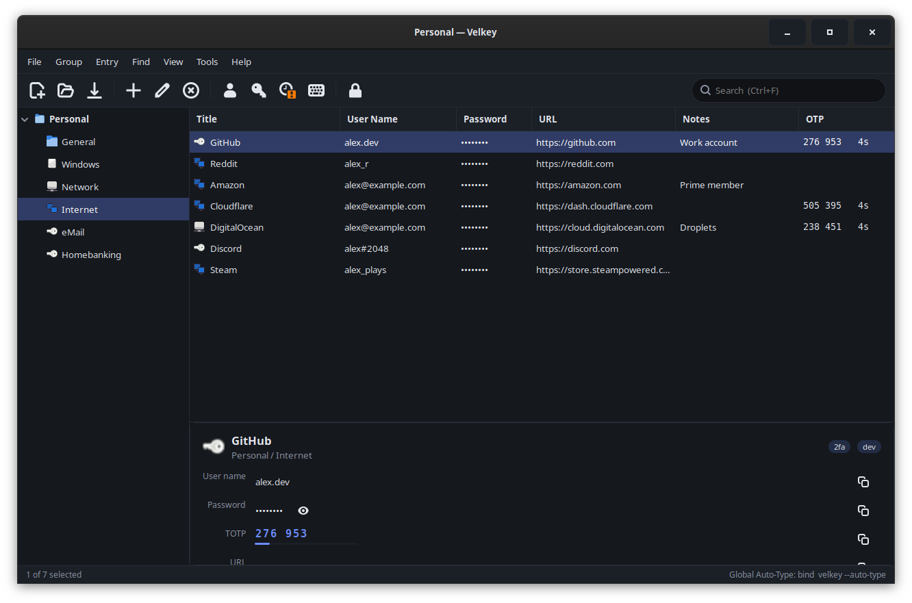

<div align="center">


# Velkey

**A fast, native password manager for Linux that opens your KeePass databases.**

Your existing `.kdbx` files · Global Auto-Type · TOTP codes · No account, no cloud

[](#-install)
[](#-security)
[](#-auto-type)
[](LICENSE)



[Install](#-install) · [Quick start](#-quick-start) · [TOTP](#-two-factor-codes-totp) · [Auto-Type](#-auto-type) · [Shortcuts](#%EF%B8%8F-keyboard-shortcuts) · [FAQ](#-faq)

</div>

---

## ✨ Why Velkey

Velkey reads and writes the same `.kdbx` files as **KeePass, KeePassXC, KeeWeb and the KeePass mobile apps**. Point it at the database you already have. You don't need to convert or import anything, and every other app can still open the file.

<table>
<tr>
<td width="50%" valign="top">

🔐 **Full KDBX 3.1 / 4.x**<br>
AES-256 or ChaCha20 · AES-KDF / Argon2d / Argon2id · password, key file, or both

⌨️ **Global Auto-Type**<br>
Press <kbd>Ctrl</kbd>+<kbd>Alt</kbd>+<kbd>Shift</kbd>+<kbd>Z</kbd> on a login page and Velkey types your login, but only into the site it belongs to

⏱ **TOTP / 2FA**<br>
Live one-time codes in the list and details panel. <kbd>Ctrl</kbd>+<kbd>T</kbd> copies the code

</td>
<td width="50%" valign="top">

🌑 **Native & dark**<br>
GTK 3 with a clean dark theme and an adjustable accent color

🪶 **Lightweight**<br>
Pure Python on what your desktop already ships (GTK 3, OpenSSL). No Electron, no daemons

🛡 **Safe saves**<br>
Atomic writes, a `.bak` of the previous version, and a warning if a sync tool changed the file

</td>
</tr>
</table>

Also included: entry history, attachments, custom fields and icons, recycle bin, tags, expiry dates, password generator, drag & drop, smart filters, tray icon, auto-lock and clipboard auto-clear.

---

## 📦 Install

```bash
git clone https://github.com/narl3yyy-svg/Velkey.git
cd Velkey
```

**Try it without installing.** Run it straight from the folder:

```bash
./run.sh
```

**Install it** (for your user only, no root) once you're happy with it:

```bash
./install.sh
```

Velkey then appears in your app menu and `.kdbx` files open in it on double-click.

| Command | What it does |
|---|---|
| `./run.sh` | Run from the folder, nothing installed. Your taskbar still shows the Velkey icon |
| `./install.sh` | Install to `~/.local` with a menu entry and `.kdbx` file association |
| `./install.sh --autostart` | Also start minimized at login so global Auto-Type is always ready |
| `./install.sh --uninstall` | Remove Velkey. Your databases and settings stay untouched |

**Requirements:** Python 3.8+, GTK 3 with PyGObject, and OpenSSL 3.2+. These are preinstalled on Ubuntu 24.04+, Fedora, Arch and most KDE / GNOME desktops. If anything is missing, the installer offers to install it.

---

## 🚀 Quick start

1. **Open** Velkey and click **Open Database…**, or **File → New Database** to start fresh.
2. **Unlock** it with your master password (and key file, if you use one), then press <kbd>Enter</kbd>.
3. **Find** an entry: pick a group on the left, or just start typing to search everything.
4. **Use** it:

| You want to… | Do this |
|---|---|
| Copy the user name / password | <kbd>Ctrl</kbd>+<kbd>B</kbd> / <kbd>Ctrl</kbd>+<kbd>C</kbd>, or double-click the cell |
| Copy the 2FA code | <kbd>Ctrl</kbd>+<kbd>T</kbd>, or double-click the OTP cell |
| Open the website | <kbd>Ctrl</kbd>+<kbd>U</kbd>, or double-click the URL |
| Log in automatically | Click into the site's login form, press <kbd>Ctrl</kbd>+<kbd>Alt</kbd>+<kbd>Shift</kbd>+<kbd>Z</kbd> |
| Add / edit an entry | <kbd>Ctrl</kbd>+<kbd>I</kbd> / <kbd>Enter</kbd> |
| Save | <kbd>Ctrl</kbd>+<kbd>S</kbd> |

Anything you copy is **wiped from the clipboard after 12 seconds** (change it in *Tools → Options*). Velkey remembers the databases you had open, but never your passwords.

---

## 🗂 Several databases at once

Open another database (<kbd>Ctrl</kbd>+<kbd>O</kbd>) and it gets **its own tab**. The databases you already have open stay open.

- Switch tabs with a click, <kbd>Ctrl</kbd>+<kbd>Tab</kbd>, or <kbd>Ctrl</kbd>+<kbd>Page Down</kbd> / <kbd>Page Up</kbd>. Drag a tab to reorder it.
- **Close** one with its **×** or <kbd>Ctrl</kbd>+<kbd>W</kbd>. **Lock** (<kbd>Ctrl</kbd>+<kbd>L</kbd>) locks all of them.
- Global Auto-Type looks in **every unlocked tab**.
- Next time you start Velkey, the same tabs come back (locked).

### Move an entry to another database

| Both databases on this computer | Taking it to another computer or person |
|---|---|
| Open both, go to the tab with the entry, right-click it → **Copy to Database** → pick the other database | Highlight one or more entries (<kbd>Ctrl</kbd>/<kbd>Shift</kbd>+click, or <kbd>Ctrl</kbd>+<kbd>A</kbd>), right-click → **Export Selected Entries…** Velkey saves them in one small **encrypted** `.kdbx` file with a password you choose |
| | In the other database: right-click → **Import Entries…** (also in the *Entry* and *File* menus), pick that file and type its password. The entries land in the selected group |

Copies keep everything: password, 2FA code, attachments, icon, Auto-Type rules and history. The original stays where it was. To move it instead, delete the original after copying. The exported file is a normal KeePass database, so KeePass and KeePassXC can open it too.

---

## ⏱ Two-factor codes (TOTP)

1. On the website, start setting up an **authenticator app**. Next to the QR code there is usually a link like *"Can't scan it?"* that shows the **setup key**.
2. In Velkey, edit the entry (<kbd>Enter</kbd>) and open the **OTP** tab.
3. Paste the **setup key** (e.g. `JBSW Y3DP EHPK 3PXP`) or a full `otpauth://` link. The live code appears under *Current code*.
4. Click **OK**, then type the code from Velkey into the website to finish setup.

> [!TIP]
> Paste the **setup key**, not the 6-digit code. Velkey warns you if you paste a code by mistake. If you copy a code with only a few seconds left, Velkey waits for the next one so it doesn't expire before you can paste it.

Codes are stored in the standard KeePass 2.47+ format, so they work in KeePass, KeePassXC and mobile apps too. Velkey also reads codes created by KeePassXC, KeeOtp and Steam Guard.

---

## ⌨️ Auto-Type

Auto-Type types your login into a website or app for you. It's faster than copy & paste, and it never touches the clipboard.

### Global Auto-Type: <kbd>Ctrl</kbd>+<kbd>Alt</kbd>+<kbd>Shift</kbd>+<kbd>Z</kbd>

1. Open the login page and **click into the user name field**.
2. Press <kbd>Ctrl</kbd>+<kbd>Alt</kbd>+<kbd>Shift</kbd>+<kbd>Z</kbd>.
3. Velkey looks at the active window, finds the matching entry and types `user name → Tab → password → Enter`. If several entries match, you get a short list to pick from.

### Auto-Type the selected entry: toolbar ⌨ button or <kbd>Ctrl</kbd>+<kbd>V</kbd>

Velkey minimizes itself and types into the window you were in before. It types **only if that window belongs to the entry**. Otherwise it cancels and tells you why.

### How Velkey knows it's the right site

In a **browser**, Velkey reads the page's real **URL** from the browser's own session file, so it knows the actual site even when the window just says *"Gmail - Helium"*. This works with Chrome, Chromium, Helium, Brave, Vivaldi, Edge, Opera, Firefox, LibreWolf and Zen (including Flatpak and Snap). Then an entry matches when:

- its **URL** is on the same site: an entry for `https://accounts.google.com` ↔ a tab on `mail.google.com`
- one of its **window rules** (Edit Entry → *Auto-Type* tab) fits. A rule that is a web address is checked against the page URL, e.g. `https://login.example.com/users/*` (KeePass's `??:URL:https://…` form works too)

When the URL is known, a page that only *looks* right (same title, different domain) is **not** matched. In other apps, or if the URL can't be found, Velkey falls back to the window title:

- its **title** or **URL domain** appears in the window title: an entry named *GitHub* ↔ *"Sign in to GitHub — Brave"*
- a window rule fits the title. Rules support `*` wildcards and `//regex//`

> [!NOTE]
> Browsers save their tab list about 2 seconds after a page loads. If you press the hot key the instant a page appears, Velkey waits a moment and checks again.

### The password only goes into a password box

Velkey checks **which field the cursor is in** before it types your password:

| Where you clicked | What Velkey does |
|---|---|
| The **password box** | Types only the password (and Enter). The user name part is skipped |
| The **user name box** | Types the user name and Tab. It types the password **only if** the cursor then lands in a password box. Otherwise it stops and tells you |
On two-step logins (Google, Microsoft…), press the shortcut once on the user name page, click **Next**, then click the password box and press it again.

Velkey reads the field type through the Linux accessibility system (AT-SPI), the same thing screen readers use. This works automatically in **Firefox** and in regular desktop apps. **Chrome, Helium, Brave and other Chromium browsers** don't report their fields unless their accessibility is turned on, so there Velkey types the usual *user name → Tab → password*, like KeePass does. The site check above still applies, so nothing is ever typed into the wrong site. There's nothing to set up either way.

If nothing matches, **nothing is typed**. You can relax this in *Tools → Options → Auto-Type → "Only type into a window that matches the entry"*, but it's on by default for your safety.

<details>
<summary><b>Custom sequences</b> (two-step logins, 2FA, special keys)</summary>

<br>

The default sequence is `{USERNAME}{TAB}{PASSWORD}{ENTER}`. Override it per group or per entry using standard KeePass syntax:

| Code | Types |
|---|---|
| `{USERNAME}` `{PASSWORD}` `{TITLE}` `{URL}` `{NOTES}` | entry fields |
| `{TOTP}` | the current one-time code |
| `{S:Field Name}` | a custom field |
| `{TAB}` `{ENTER}` `{SPACE}` `{BS}` `{DEL}` `{ESC}` `{UP}` `{F1}`… | special keys (`{TAB 3}` repeats) |
| `{DELAY 500}` / `{DELAY=50}` | pause once / set delay between keys (ms) |
| `{CLEARFIELD}` | select all and delete |
| `+` `^` `%` `~` | Shift, Ctrl, Alt, Enter (`^a` = Ctrl+A) |

Example for a two-step login with 2FA:

```
{USERNAME}{ENTER}{DELAY 1500}{PASSWORD}{ENTER}{DELAY 2000}{TOTP}{ENTER}
```

</details>

<details>
<summary><b>Hot key setup per desktop</b></summary>

<br>

| Desktop | Setup |
|---|---|
| **KDE Plasma** (Wayland & X11) | Automatic. Change it in *Tools → Options → Auto-Type* or *System Settings → Shortcuts → Velkey* |
| **GNOME** | Added by `install.sh` as a custom keyboard shortcut |
| **Other X11 desktops** | Grabbed directly by Velkey |
| **Sway, Hyprland, …** | Bind `velkey --auto-type` in your compositor config |

On **Wayland**, the first Auto-Type asks once for permission to send keyboard input. Choose **Allow** (and *Remember* if offered). Global Auto-Type works while Velkey is running, so use `--autostart` or *close to tray* to keep it ready.

</details>

---

## ⌨️ Keyboard shortcuts

| Shortcut | Action | | Shortcut | Action |
|---|---|---|---|---|
| <kbd>Ctrl</kbd>+<kbd>Alt</kbd>+<kbd>Shift</kbd>+<kbd>Z</kbd> | Global Auto-Type | | <kbd>Ctrl</kbd>+<kbd>I</kbd> | Add entry |
| <kbd>Ctrl</kbd>+<kbd>V</kbd> | Auto-Type selected entry | | <kbd>Enter</kbd> | Edit entry |
| <kbd>Ctrl</kbd>+<kbd>B</kbd> | Copy user name | | <kbd>Ctrl</kbd>+<kbd>K</kbd> | Duplicate entry |
| <kbd>Ctrl</kbd>+<kbd>C</kbd> | Copy password | | <kbd>Delete</kbd> | Delete entry |
| <kbd>Ctrl</kbd>+<kbd>T</kbd> | Copy TOTP code | | <kbd>F2</kbd> | Edit group |
| <kbd>Ctrl</kbd>+<kbd>U</kbd> | Open URL | | <kbd>Ctrl</kbd>+<kbd>F</kbd> | Search |
| <kbd>Ctrl</kbd>+<kbd>Shift</kbd>+<kbd>U</kbd> | Copy URL | | <kbd>Ctrl</kbd>+<kbd>G</kbd> | Password generator |
| <kbd>Ctrl</kbd>+<kbd>S</kbd> | Save | | <kbd>Ctrl</kbd>+<kbd>L</kbd> | Lock workspace |
| <kbd>Ctrl</kbd>+<kbd>O</kbd> / <kbd>Ctrl</kbd>+<kbd>N</kbd> | Open / new database (new tab) | | <kbd>Ctrl</kbd>+<kbd>Q</kbd> | Quit |
| <kbd>Ctrl</kbd>+<kbd>Tab</kbd> | Next database tab | | <kbd>Ctrl</kbd>+<kbd>W</kbd> | Close database tab |

---

## ⚙️ Settings

**Tools → Options**

- **Security:** clipboard clear time, lock after inactivity, lock with the screen or on minimize
- **Interface:** tray icon, minimize / close to tray, start minimized, hide passwords or user names, OTP column, accent color
- **Auto-Type:** hot key (click and press a new combo), typing speed, URL matching, strict window matching, always show the picker
- **Files:** reopen last database, keep `.bak` backups, auto-save

**File → Database Settings** covers name, encryption, key derivation, recycle bin and history limits. **File → Change Master Key** changes your password or key file.

---

## 🔒 Security

- All encryption runs through your system's **OpenSSL**. There is no hand-rolled crypto for the heavy lifting.
- Your master password is never stored. Only the path of the last database and key file is remembered (`~/.config/velkey/config.json`).
- Databases are saved as **KDBX 4.1**. KDBX 3.1 files are upgraded on first save. KeePass 2.35+, KeePassXC and current mobile apps all read KDBX 4.
- **Not supported:** Twofish databases (a KeePass plugin cipher), KeePass 1.x `.kdb` files, KeePass plugins.

---

## 🧩 Command line

```text
velkey [FILE.kdbx]     open Velkey (optionally with a database)
velkey --auto-type     trigger global Auto-Type in the running instance
velkey --lock          lock the running instance
velkey --minimized     start minimized (to the tray if available)
velkey --version
```

(Use `./run.sh` in place of `velkey` when running from the folder.)

---

## ❓ FAQ

<details>
<summary><b>The hot key does nothing</b></summary>

<br>

- Velkey must be **running** (it can be minimized or in the tray).
- The database must be **unlocked**. If it's locked, Velkey pops up and asks for your password first.
- The window must **match an entry** (see [How Velkey knows it's the right site](#how-velkey-knows-its-the-right-site)). If none matches, you get a notification that nothing was typed.
- On KDE, check that nothing else uses the shortcut: *System Settings → Shortcuts → Velkey*.

</details>

<details>
<summary><b>Can I get the password-box check in Chrome / Helium / Brave too?</b></summary>

<br>

Yes, optionally. Those browsers only report their fields when started with `--force-renderer-accessibility` (add it to the end of the `Exec=` line in the browser's `.desktop` file), or for one session via `chrome://accessibility` → *Native accessibility API support*. To see what Velkey sees, run `VELKEY_DEBUG=1 ./run.sh` and click a password box. A line like `[velkey a11y] focus … role=password text` should appear.

</details>

<details>
<summary><b>The website says my 2FA code is wrong</b></summary>

<br>

- Make sure you pasted the **setup key** in the OTP tab, not a 6-digit code.
- Check that your computer clock is correct (`timedatectl` should show *System clock synchronized: yes*).
- Some sites use 8 digits or SHA-256. Paste the full `otpauth://` link, which carries those settings.

</details>

<details>
<summary><b>Can I keep using KeePass / KeePassXC on the same file?</b></summary>

<br>

Yes. Velkey keeps everything in the standard format, including TOTP, history and attachments. If the file changes on disk while Velkey has it open (e.g. from Syncthing or Nextcloud), Velkey warns you before saving.

</details>

---

<div align="center">

Free software under the [GNU GPL v3.0](LICENSE).<br>
<sub>Velkey is an independent project and is not affiliated with KeePass or Dominik Reichl.</sub>

</div>
